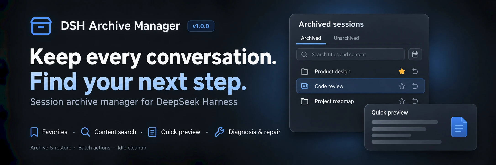
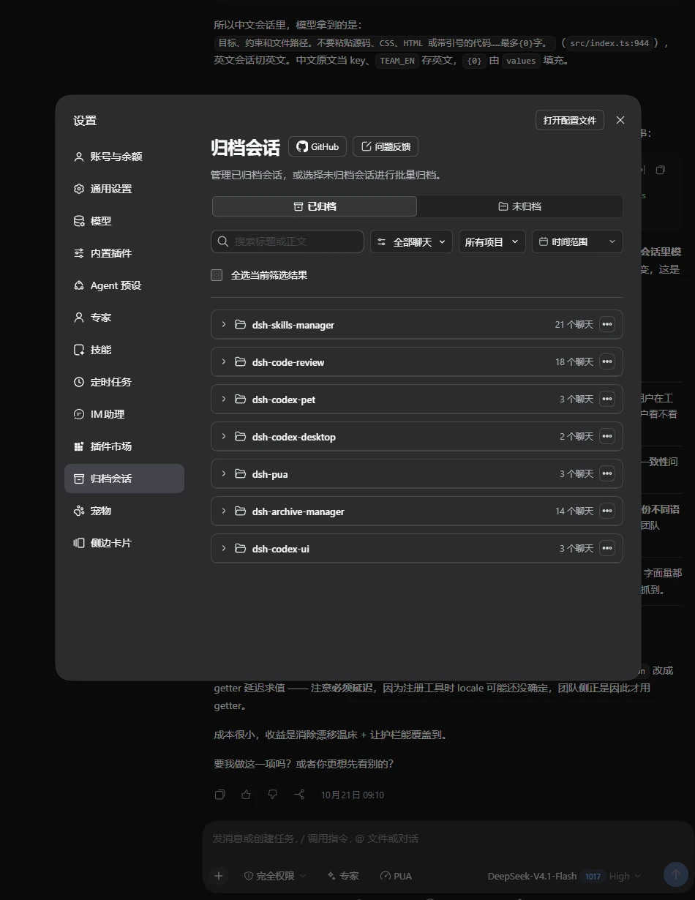
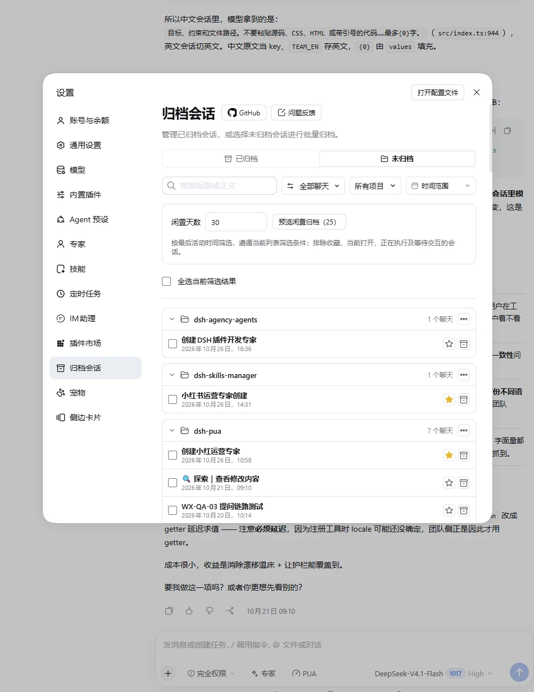
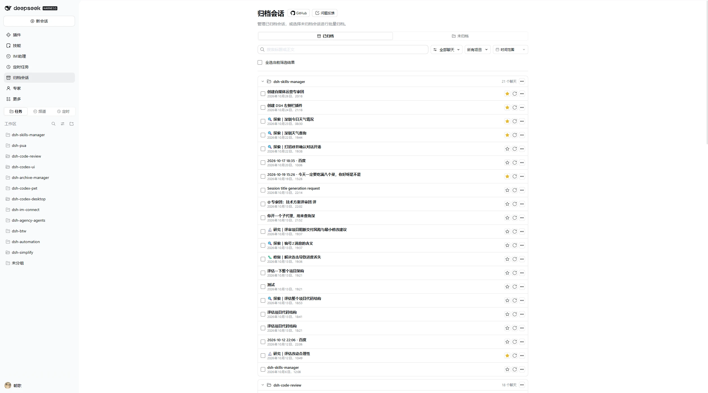
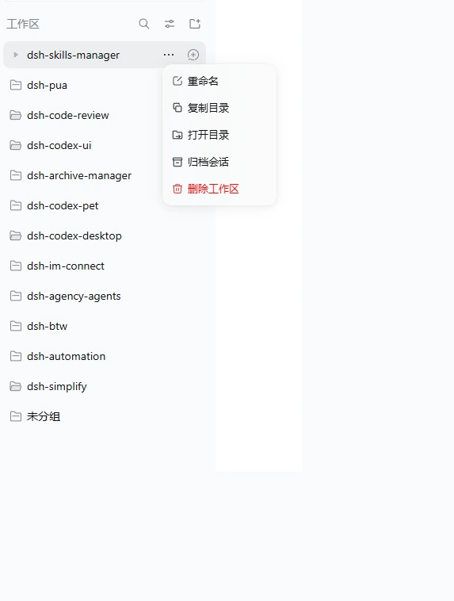
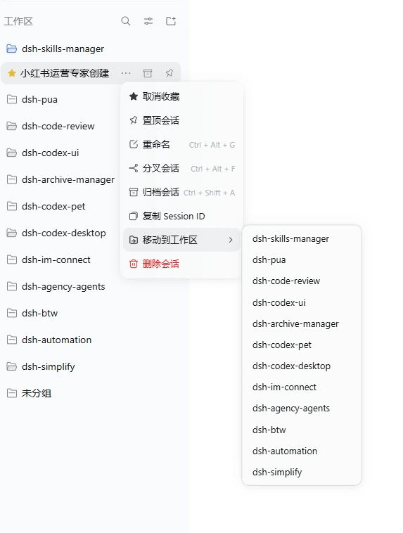

<p align="center">
  
</p>

<div align="center">

  # DSH Archive Manager

  **Gestion sécurisée des sessions archivées dans DeepSeek Harness**

  [简体中文](README.zh-CN.md) · [English](README.en.md) · [日本語](README.ja.md) · [Español](README.es.md) · [Français](README.fr.md) · [Deutsch](README.de.md) · [Русский](README.ru.md) · [Português](README.pt.md)

  [Journal des modifications](CHANGELOG.md) · [Apache-2.0](LICENSE)

  [](LICENSE)
  [](https://www.npmjs.com/package/@michengai/dsh-archive-manager)
  [](https://www.npmjs.com/package/@michengai/dsh-archive-manager)
  [](https://github.com/MichengAI/dsh-archive-manager)
  [](#installation)
</div>

> DSH Archive Manager est un plugin maintenu par la communauté pour DeepSeek Harness (DSH), et n'est pas un produit officiel de DeepSeek AI.

Ce document décrit la version **1.3.2**. Consultez le [journal des modifications](CHANGELOG.md) pour les versions publiées.

## Vue d'ensemble

Mettez de côté vos conversations inactives et retrouvez-les au besoin, pour une liste de travail claire et aérée.

- **Double accès et vue large** : Gérez vos sessions depuis **Paramètres → Sessions archivées**, ou activez l'icône dans la barre latérale principale pour ouvrir un panneau centré dans l'espace de travail.
- **Archivage et restauration** : Archivez des discussions individuelles, des espaces de travail entiers ou des lots multi-projets, et restaurez ou reprenez vos sessions directement.
- **Recherche plein texte et aperçu rapide** : Recherchez simultanément dans les titres et l'historique des messages, combinez filtres par projet, favoris et plage de dates avec tri flexible, et prévisualisez le contexte en Markdown ou texte source surligné sans restaurer.
- **Favoris et nettoyage des inactifs** : Épinglez vos discussions importantes et filtrez via **Favoris uniquement** ; prévisualisez et archivez les discussions inactives selon un seuil de jours tout en protégeant les tâches en cours, les invites en attente et les favoris, avec annulation immédiate du lot.
- **Actions dans la barre latérale et déplacement entre espaces** : Faites un clic droit sur les lignes d'espace de travail ou de session dans la barre latérale pour mettre en favori, archiver, déplacer une session standard vers un autre espace ou copier/ouvrir le dossier du projet.
- **Nettoyage des sous-agents orphelins et suppression définitive** : Détectez et nettoyez les sous-agents résiduels dont la session mère a été supprimée en externe, et purgez définitivement les sessions et journaux indésirables après confirmation.
- **Multilingue et compatible proxy inverse** : Prend en charge les 8 langues intégrées de DeepSeek Harness, suit le thème clair/sombre et fonctionne derrière un proxy inverse avec préfixe de chemin.

## Captures d'écran

### 1. Panneau de gestion des archives

Recherchez, mettez en favori, prévisualisez, restaurez et nettoyez dans **Paramètres → Sessions archivées → Archivées** :



Passez à **Non archivées** pour prévisualiser le nettoyage des sessions inactives ou archiver par projet :



### 2. Panneau principal de l'espace de travail (accès barre latérale)

Lorsque l'accès barre latérale est activé, cliquez sur l'icône de navigation à gauche pour ouvrir la vue complète :



### 3. Menus contextuels et déplacement dans la barre latérale

Faites un clic droit sur une ligne d'espace de travail ou de session dans la barre latérale pour accéder aux actions rapides et au déplacement entre espaces :

| Actions d'espace de travail (Copier/Ouvrir le dossier) | Déplacer la session vers un autre espace |
| :---: | :---: |
|  |  |

## Installation

Un environnement DeepSeek Harness opérationnel est requis. Les exemples utilisent le profil `web` ; adaptez selon votre configuration.

- **Compatibilité hôte** : Série DeepSeek Harness `0.2.x` (`>=0.2.0-rc.1 <0.3.0-0`), validée sur toutes les versions candidates `0.2.x` (`0.2.0-rc.1` à `0.2.2-rc.2` ; les alphas intermédiaires ne sont pas pris en charge).
- Les versions antérieures à `0.2.0-rc.1` ne sont plus prises en charge, et la génération `0.3.0` est bloquée par le contrôle de version. Les utilisateurs sur `0.1.x` doivent installer la version `1.0.20`.
- **Support proxy inverse** : Fonctionne derrière un proxy inverse avec préfixe de chemin (ex. `/app/dsh/`).

### Demander à un agent d'installer (recommandé)

Envoyez cette instruction à un agent disposant d'un accès terminal :

```text
Installez la dernière version de @michengai/dsh-archive-manager dans mon profil web DSH depuis le registre officiel npm, vérifiez l'activation et expliquez comment recharger.
```

### Installation manuelle et mise à jour

```powershell
[Console]::OutputEncoding = [System.Text.Encoding]::UTF8
$OutputEncoding = [System.Text.Encoding]::UTF8

dsh plugin --profile web add @michengai/dsh-archive-manager@latest --registry=https://registry.npmjs.org/
```

Redémarrez DSH Web puis forcez le rechargement du navigateur (`Ctrl+Shift+R`), et ouvrez **Paramètres → Sessions archivées**. Pour mettre à jour, relancez simplement la commande d'installation.

## Configuration du plugin

Ouvrez **Barre latérale → Plugins → `Archive Manager`** pour configurer :

- **Emplacement de l'accès (`entryLocation`)**
  - **Les deux (`both`)** : Affiche l'icône dans la barre latérale gauche et conserve **Paramètres → Sessions archivées**.
  - **Barre latérale uniquement (`sidebar`)** : Affiche l'icône dans la barre latérale gauche et masque l'entrée dans les Paramètres.
  - **Paramètres uniquement (`settings`)** (Défaut) : Conserve l'accès uniquement dans **Paramètres → Sessions archivées**.
- **Étoile de favori dans la barre latérale (`sidebarFavoriteStar`)**
  - **Tout afficher (`all`)** (Défaut) : Affiche l'étoile au survol et sur les sessions favorites.
  - **Favoris uniquement (`favorites`)** : Affiche l'étoile uniquement sur les sessions favorites ; masque l'étoile au survol sur les autres lignes.
  - **Tout masquer (`none`)** : Masque les étoiles sur les lignes de la barre latérale (vous pouvez toujours gérer les favoris via le menu contextuel et filtrer avec **Favoris uniquement**).

## Guide d'utilisation

| Action | Procédure |
| --- | --- |
| **Archiver des sessions** | Choisissez **Archiver la session** dans le menu contextuel de la barre latérale, ou sélectionnez des sessions dans **Non archivées** pour un archivage par lot |
| **Archiver un espace / groupe** | Choisissez **Archiver l'espace de travail** dans le menu de l'espace, ou utilisez le menu **…** d'un groupe dans **Non archivées** (ignore les filtres de recherche) |
| **Rechercher et filtrer** | La recherche couvre titres et corps de messages ; combinez **Favoris uniquement**, tri, filtre par projet et plage de dates (le calendrier inclut préréglages et navigation clavier) |
| **Aperçu rapide** | Cliquez sur un extrait ou **Plus d'actions → Aperçu rapide** pour inspecter le contexte sans restaurer |
| **Consulter ou restaurer** | Cliquez sur le titre pour lire et poursuivre la discussion tout en la gardant archivée ; cliquez sur restaurer ou **Plus d'actions → Restaurer et ouvrir** |
| **Mettre en favori** | Cliquez sur l'étoile de la ligne ou utilisez le menu contextuel, puis filtrez via **Favoris uniquement** |
| **Nettoyer les inactives** | Dans **Non archivées**, définissez les jours d'inactivité (1–36 500), prévisualisez les candidats et confirmez ; utilisez **Annuler cet archivage** avant de fermer ou d'actualiser |
| **Déplacer entre espaces** | Faites un clic droit sur une session standard dans la barre latérale et choisissez **Déplacer vers l'espace de travail** |
| **Nettoyer les sous-agents orphelins** | Lorsque des sous-agents dont la session mère a été supprimée en externe sont détectés, cliquez sur nettoyer dans le panneau d'organisation pour libérer l'espace disque |
| **Reconstruire le cache de liste** | Si des entrées officielles de cache manquent, cliquez sur la carte de reconstruction pour relire les journaux en lecture seule et restaurer les titres |
| **Suppression définitive** | Sélectionnez des sessions et cliquez sur **Supprimer** (ou via le menu contextuel) pour effacer définitivement journaux et caches après confirmation |
| **Copier l'ID de session** | Choisissez **Copier l'ID de session** dans le menu **Plus d'actions** |

### Remarques

- **Favoris et protection des inactives** : Les favoris sont stockés par l'hôte et conservés lors de l'archivage ou de la restauration. Le nettoyage des inactives exclut automatiquement les favoris, la session ouverte, les sessions en cours d'exécution et les interactions en attente ; les favoris restent archivables manuellement. Il n'y a pas d'archivage automatique en arrière-plan.
- **Portée de recherche** : La recherche plein texte porte sur les messages utilisateur et assistant, à l'exclusion des sorties d'outils, pièces jointes, raisonnements et messages système. Il n'existe pas d'index persistant : filtrer par projet, date ou favoris accélère les recherches sur les historiques volumineux.
- **Opérations par lot et annulation** : Les lots d'archivage, de restauration et de suppression poursuivent en cas d'échec individuel et permettent de réessayer uniquement les éléments en échec. **Annuler cet archivage** n'est disponible que tant que la page de gestion reste ouverte. La suppression définitive est irréversible.

## FAQ

### Pourquoi l'entrée n'apparaît-elle pas après l'installation ?

Redémarrez DSH Web, forcez le rechargement du navigateur (`Ctrl+Shift+R`) et vérifiez l'installation dans le profil actif. Si rien n'apparaît, exécutez la commande ci-dessous pour vérifier la présence de `ui-workspace-archive-manager` et que `cordis.patch.yml` ne désactive pas `workspace`, `session-projection-cache` ou `ui-workspace` :

```powershell
[Console]::OutputEncoding = [System.Text.Encoding]::UTF8
$OutputEncoding = [System.Text.Encoding]::UTF8

dsh --profile web --dump-config
```

### Quelle est la différence entre archiver et supprimer définitivement ?

L'archivage met une conversation de côté afin de pouvoir la restaurer à tout moment. **La suppression définitive est irréversible** et efface journaux, caches et pièces jointes (votre répertoire de projet n'est jamais supprimé). Une confirmation est toujours demandée.

### Est-ce compatible avec Codex UI ou d'autres plugins d'archivage ?

Oui. Le plugin fonctionne avec [Codex UI](https://github.com/MichengAI/dsh-codex-ui), et si d'autres plugins d'archivage sont installés, chacun affiche son entrée de paramètres indépendamment.

Pour tout autre problème, ouvrez un [issue](https://github.com/MichengAI/dsh-archive-manager/issues) avec les versions de DSH et du plugin, les étapes de reproduction et les détails d'erreur.

## Installation depuis les sources

<details>
<summary>Déplier pour le développement ou tester des modifications non publiées</summary>

```powershell
[Console]::OutputEncoding = [System.Text.Encoding]::UTF8
$OutputEncoding = [System.Text.Encoding]::UTF8

git clone https://github.com/MichengAI/dsh-archive-manager.git
Set-Location .\dsh-archive-manager
pnpm install --frozen-lockfile
pnpm build
dsh plugin --profile web add .
```

Redémarrez DSH Web et rechargez la page. Après modification de [src](src), exécutez `pnpm build` avant de commiter (vérifications : `pnpm typecheck`, `pnpm test`, `pnpm verify`).

</details>

## Écosystème de produits DSH

Pour un poste de travail complet, téléchargez [DSH Codex Desktop](https://github.com/MichengAI/dsh-codex-desktop/releases). Pour [DeepSeek Harness](https://github.com/deepseek-ai/deepseek-harness), ajoutez les plugins selon vos besoins :

| Plugin | Capacités principales |
| --- | --- |
| [Codex UI](https://github.com/MichengAI/dsh-codex-ui) | Organisation des projets, recherche de tâches et navigation dans les messages |
| [Agency Agents](https://github.com/MichengAI/dsh-agency-agents) | Sélection et invocation d'agents spécialistes |
| [Skills Manager](https://github.com/MichengAI/dsh-skills-manager) | Recherche, activation, création et importation de compétences locales |
| [Archive Manager](https://github.com/MichengAI/dsh-archive-manager) | Recherche, restauration et nettoyage physique des discussions archivées |
| [IM Connect](https://github.com/MichengAI/dsh-im-connect) | Envoi de tâches et réception de réponses via vos messageries préférées |
| [Automation](https://github.com/MichengAI/dsh-automation) | Planification de tâches récurrentes et suivi des exécutions |
| [BTW](https://github.com/MichengAI/dsh-btw) | Questions annexes sans interrompre la tâche principale |
| [Simplify](https://github.com/MichengAI/dsh-simplify) | Utilisation de `/simplify` pour perfectionner le code modifié dans Git |
| [PUA](https://github.com/MichengAI/dsh-pua) | Incitation de l'agent à persévérer et vérifier ses résultats avant de conclure |
| [Code Review](https://github.com/MichengAI/dsh-code-review) | Revue de code indépendante avec `/review` directement dans la discussion |
| [Codex Pet](https://github.com/MichengAI/dsh-codex-pet) | Notifications et approbations d'outils via un compagnon de bureau |

## Licence

Distribué sous [Licence Apache 2.0](LICENSE).
