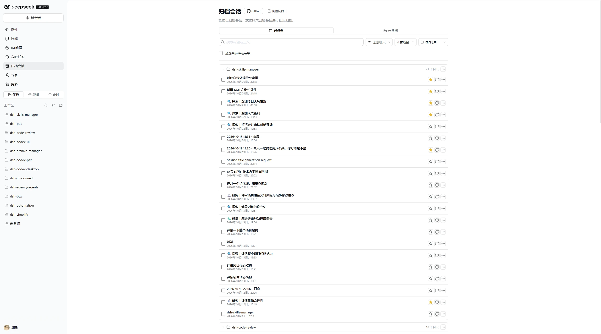
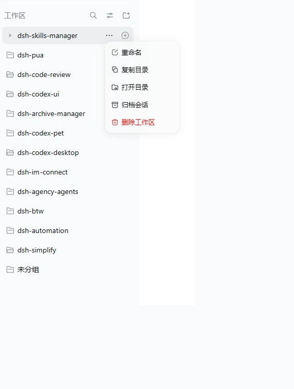
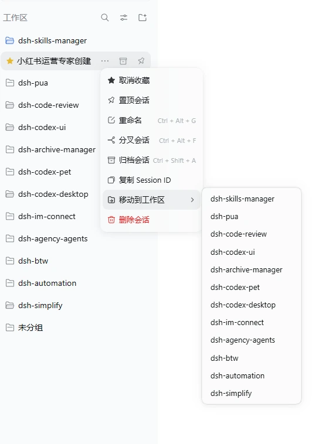

<p align="center">
  
</p>

<div align="center">

  # DSH Archive Manager

  **Safely manage archived sessions in DeepSeek Harness**

  [Русский](README.ru.md) · [简体中文](README.zh-CN.md) · [Changelog](CHANGELOG.md) · [Apache-2.0](LICENSE)

  [](LICENSE)
  [](https://www.npmjs.com/package/@michengai/dsh-archive-manager)
  [](https://www.npmjs.com/package/@michengai/dsh-archive-manager)
  [](https://github.com/MichengAI/dsh-archive-manager)
  [](#prerequisites)
</div>

> DSH Archive Manager is a community-maintained DeepSeek Harness (DSH) plugin, not an official DeepSeek AI product.

This document describes **1.1.17**. See [Changelog](CHANGELOG.md) for published releases.

## Overview

Put inactive conversations away and find them again when needed, keeping everyday task lists tidy.

- **Dual views & primary sidebar entry**: Toggleable persistent icon on the host's primary sidebar opens a **960px centered workspace view** for both Archived and Unarchived sessions, eliminating narrow dialog scrolling constraints.
- **Full lifecycle session management**: Archive individual chats, all chats in a workspace, cross-project batches, and restore or open sessions seamlessly.
- **Full-row sidebar right-click actions**: Right-click directly anywhere on sidebar workspace or session rows to trigger dedicated actions menus; passes through native system context menus on ungrouped or blank rows without accidental clicks.
- **Zero-jitter star alignment (#90)**: Standardizes favorite stars to 16×16px size and overlays the host leading slot via absolute positioning, eliminating horizontal title jitter and custom skin conflicts (such as orca-link).
- **Workspace quick action menu**: Provides fast "Copy folder path", "Open folder" (directly opens in Windows Explorer or macOS Finder), and one-click "Archive sessions" in the sidebar workspace menu.
- **Move session across workspaces**: Move conversations across project workspaces via a cascading hover submenu with process quiescence, atomic rewriting, instant projection pre-warming, and NTFS colon-safety for IM sessions.
- **Unified accordion cards & 40px ultra-compact rows**: Unifies workspace groups with Skills Manager-style integrated drawer cards (38px header); compacts session row height to 40px for doubled information density.
- **Host-native dark mode checkboxes**: Reverts checkbox styling strictly to host primitive Checkbox specifications using native `accent-color`, perfectly blending with dark backgrounds and brand blue checked states.
- **Anti-bleedthrough modals & localized accessibility**: Mounts wide preview dialogs directly to body (`portalToBody`) with solid backing and frosted blur to prevent text bleedthrough; adds comprehensive trilingual close button accessibility labels (`common.close`).
- **Standardized section ID & coexistence compatibility (#91)**: Section ID updated to `archive-manager` with runtime fail-soft `try/catch` protection, ensuring smooth coexistence with third-party archive plugins.
- **Clean single-line adaptive toolbar**: Uses the host's native `Input` primitive with an official search icon and glowing green focus border, flexibly expanding to fill remaining width; arranged as search input, view filter/sort menu, project filter, and date range in a clean single line with strict box-model boundaries.
- **Unified full-text search & Codex composite menu**: Search automatically covers both conversation titles and body history (including user and assistant messages) by default; consolidates session filtering (all / favorites only) and sorting into a two-section Codex-style menu with native checkmarks.
- **Lightweight DateRange capsule & calendar popover**: Completely replaces the native date input to eliminate dark-mode inversion and focus loss (#74); displays the selected range in a single line with a dedicated clear button; supports quick presets, localized English/Chinese/Russian typography, and full WAI-ARIA keyboard navigation (arrows, Home/End, PageUp/Down with month-end clamping) with real-time range stretch preview.
- **Automated idle session cleanup**: Specify an idle threshold in days to discover inactive chats, automatically protecting running tasks, interactive prompts, and starred items, with instant undo support.
- **Permanent deletion**: Thoroughly purge unwanted transcripts, cache rows, and indexes with per-item retry reporting.
- **Orphan subagent detection & cleanup**: Automatically detect residue subagents whose parent sessions were externally deleted, displaying disk usage and enabling safe one-click reclamation.
- **Controlled online updates & reverse proxy ready**: Features a toggleable online update switch, enterprise host-level configuration locking, and native baseURI dynamic endpoint resolution for prefix-stripping reverse proxies.

## Manual list-cache rebuild (#88)

Opening Archive Manager checks only headers and official cached projections for ordinary cold sessions in registered workspaces, ungrouped lists, and archives, while excluding special IM channel sessions (`im:`). A repair card appears only for missing/incompatible caches or an unavailable title projection. Click to read complete logs one at a time through read-only handles and rebuild registered projections with official `coldSnapshot`, saving to official `session_projcache`.

No old plugin domains are scanned, no JSON is copied, no Session/Agent is activated, no model is called, and archives/schedules remain unchanged. Active sessions are skipped; failed items can be retried individually; feedback provides a "Done" dismiss button and auto-dismisses when clear. The official session list is refreshed and candidates checked again afterward. A persistence-confirmation timeout means unknown, not cancelled: deletion remains ordered after pending native writes. Closing the page stops later requests, not the one already sent.

## Orphan subagent cleanup

When parent sessions are deleted externally or via the host, orphaned subagents may remain on disk. The Archive Manager detects these orphan sessions in the Organizer panel, calculates disk space usage, and provides one-click physical deletion.

## Search and preview

- Archived and Unarchived share title/content search, project, favorites, updated-date filters, and creation-time sorting. Star or unstar conversations on either tab.
- Search automatically covers both conversation titles and body history (including user and assistant messages) by default. Date filters include the entire local end date and combine with project and favorites.
- Matches show snippets and highlights. On Archived, click a snippet or **More → Quick preview** to inspect context without restoring. On Unarchived, a snippet opens the full conversation.
- Preview renders Markdown tables, quotes, and code blocks with role labels; switch to source text for highlights. It shows up to eight recent messages, or context around the first match. Each message is limited to 2,000 UTF-16 code units without splitting Unicode characters.
- Search accepts up to 200 query characters and reads batches of at most 20 sessions, sequentially within each batch. Tools, attachments, reasoning, system messages, and plugin injections are excluded. Read failures remain visible and can be retried. Stored text is not the model's current context.
- There is no persistent full-text index. Large or long conversations can be slow; narrow project, dates, or favorites first. No session-count or latency guarantee has been established. Changing filters prevents later batches and stale results, but cannot interrupt the batch already reading.

## Screenshots

### 1. Archive Settings Management (Accordion Cards & Dark Mode Checkboxes)

Search, favorite, preview, restore, and clean up in **Settings → Archived sessions → Archived** with integrated drawer cards, 40px ultra-compact rows, and native dark mode checkboxes:


Switch to **Unarchived** for smart idle cleanup suggestions, one-click archiving, and project-wide operations:


### 2. Centered Full-Screen Workspace Panel (Direct Sidebar Entry)

With the sidebar entry enabled, open a full-featured 960px centered workspace panel directly from the main sidebar:



### 3. Native Sidebar Full-Row Right-Click & Cascading Menus

Right-click directly on any workspace or session row in the primary sidebar to open context menus and cascading workspace migration submenus:

| Workspace Actions (Copy/Open Folder) | Move Session Across Workspaces (Cascading Submenu) |
| :---: | :---: |
|  |  |

*Screenshots showcase the core management panels, centered workspace view, and native sidebar context menu enhancements in lossless WebP format.*

## Installation

A working DeepSeek Harness environment is required. Examples use the `web` profile; adjust to your environment.

Plugin installation supports npm registry, locally built `.tgz` packages, and GitHub. Both GitHub and npm contain runnable `lib` artifacts.

### Ask an agent to install it

Send this prompt to an agent that can run terminal commands on your computer:

```text
Please install the latest @michengai/dsh-archive-manager into my DSH web profile using the official npm registry, verify activation, and explain how to reload.
```

### Install manually

```powershell
[Console]::OutputEncoding = [System.Text.Encoding]::UTF8
$OutputEncoding = [System.Text.Encoding]::UTF8
dsh plugin --profile web add @michengai/dsh-archive-manager@latest --registry=https://registry.npmjs.org/
```

Restart DSH Web, then refresh the page (or hard-refresh with `Ctrl+Shift+R`). Open **Settings → Archived sessions** to get started. To update, click **Check for updates** or re-run the installation command.

- Host compatibility: Full DeepSeek Harness `0.2.x` line (`>=0.2.0-rc.1 <0.3.0-0`), verified with `0.2.0-rc.1`, `0.2.0-rc.2`, `0.2.1-rc.1`, `0.2.1-rc.2`, and `0.2.1-rc.3`, and forwards-compatible with subsequent `0.2.x` releases, alphas, and RCs without requiring routine plugin version bumps.
- Legacy hosts prior to `0.2.0-rc.1` are no longer supported. The version gate cleanly intercepts breaking changes in the `0.3.0` generation. Users on `0.1.x` hosts should install `1.0.20`.
- **Reverse proxy deployment**: Supports hosting DSH behind prefix-stripping reverse proxies (e.g. `/app/dsh/`). API and update endpoints automatically resolve against the page base URI (`document.baseURI`), preventing 404 errors caused by lost prefix segments.

## Plugin Configuration & Toggles

The plugin follows standard DSH bundle configuration conventions. Options are located at:
> **Sidebar → Plugins → Click `Archive Manager`** (the host's `plugins.bundle.config` slot).

Two native switches are available:

### 1. Sidebar Entry (`sidebarEntry`)
- **Default**: Disabled (`false`)
- **Description**: Displays a persistent **Archive** navigation icon in the host's left primary sidebar under **Plugins**.
- **Effect**:
  - When enabled, clicking the sidebar icon opens the Archive Manager directly in the primary workspace with a **960px centered container** (matching host plugin manager conventions). This eliminates vertical scrolling constraints in narrow settings dialogs;
  - When disabled, unregisters the sidebar entry cleanly (and resets the active panel gracefully if currently viewing the panel, preventing blank views);
  - The standard **Settings → Archived sessions** view remains active either way, and state is synchronized live across both entry points.

### 2. Online Updates (`onlineUpdate` / `updater`)
- **Default**: Enabled (`true`)
- **Description**: Controls whether the plugin checks for and installs updates from npm.
- **Effect**:
  - **Dynamic UI Sync**: Disabling the toggle hides the **Check for updates** button and version badge in the header immediately without requiring a full page reload;
  - **Endpoint Guard**: When disabled, the update API route returns `HTTP 403` for all check and install requests, preventing unreviewed updates;
  - **Host / Platform Lock**: For curated plugin indexes (such as VibeDev) or restricted enterprise environments, this can be locked directly via Cordis configuration (bundle patch) without needing UI interaction:
    ```yaml
    updater: false # or onlineUpdate: false
    ```
    Once configured, the updater is disabled at startup, the update action stays hidden, and the online-update switch is disabled. The host lock takes precedence over the user's choice in settings.json and cannot be lifted through the UI. Removing the host lock restores the saved user preference.

## Usage Guide

| Action | How to do it |
| --- | --- |
| **Archive one chat** | Open the session context menu in the sidebar and choose **Archive session** |
| **Archive a workspace** | Open the workspace menu and choose **Archive session** (opens an in-place confirmation overlay) |
| **Search & filter** | Open **Settings → Archived sessions** or click **Archive** in the sidebar; search bar automatically covers titles and body messages; use the Codex-style view menu to filter (all / favorites only) and sort; select projects from dropdown; pick dates with the single-field capsule |
| **Custom calendar & keyboard nav** | Click the date capsule to open the lightweight calendar popover; supports all time and quick presets; provides complete WAI-ARIA keyboard navigation (arrows, Home/End, PageUp/Down, Enter/Space) and real-time range stretch preview |
| **Quick preview** | Click a match snippet or **More → Quick preview** to inspect context with highlights without restoring |
| **Adjust ordering** | Sort by recently archived, update time, creation time, or title in the view menu |
| **Restore a chat** | Click the restore icon on any row; use **More → Restore and open** to resume the chat directly |
| **Archive entire group** | On **Unarchived**, click the **…** menu next to a group and confirm archiving all chats in that project |
| **Favorite chats** | Click the star icon on any row; use the view menu to filter starred chats |
| **Clean up idle chats** | On **Unarchived**, set an idle day threshold, automatically protecting running and starred chats, preview candidates, and confirm |
| **Copy session ID** | Select **Copy session ID** from the **More** menu |
| **Clean up orphan subagents** | Detect and physically delete orphan subagents in the Organizer panel |
| **Archive across projects** | Switch to **Unarchived**, select sessions across projects, then click **Archive** and confirm |
| **Restore or delete in bulk** | Select chats and use the bulk actions, or use the project menu; there are no separate Restore all / Delete all buttons |

The page opens on **Archived**, with **Unarchived** on the right. Switching tabs clears selections; changing search or project filters preserves them. Check the hidden selection count before applying bulk actions, or clear your selection first.

**Select all filtered results** selects matching sessions, including collapsed groups. Project-wide actions still apply to the whole project regardless of search filters. Unarchived excludes subagents and blank placeholders.

Settings and sidebar batch archive/restore call the official single-session APIs `ctx.workspaces.archiveSession` and `ctx.workspaces.unarchiveSession` serially.

### Favorites and idle cleanup

Compact project groups can be collapsed. Stars and restore/archive icons appear on the right; archived session menus include restore-and-open and deletion.

- Use the star on either tab and the **Favorites only** dropdown to find important chats. Favorites persist on the host across archive, restore, and browser changes. Reopen management to see changes made in other pages. Unknown or unreadable sessions retain their stored favorite IDs; cleanup requires confirmed artifact absence.
- On Unarchived, enter 1–36,500 whole idle days and preview candidates under the current filters. Deselect individual candidates before confirmation. Favorites, the current chat, running sessions (including subagents), and pending interactions are protected; sessions without a valid activity time are excluded.
- Archive rechecks favorites and activity. Batch archive, restore, and delete report progress plus successful, skipped, and failed counts. A failure does not stop the rest; retry only the failed items. Delete retries still require confirmation.
- **Undo this archive** restores sessions archived by the current batch, including successful retries. It is available only while the current management page remains open; refreshing or closing clears it. Permanent deletion cannot be undone.
- Favorites can still be archived manually. Protection applies to idle cleanup only. There is no scheduled or automatic background cleanup.

### View and continue archived conversations

Native conversation navigation has been available since `0.1.40`; 1.0.0 uses these entry points:

- **Click the session title**: open the native DSH session to view messages, attachments, and tool details. Continue chatting while keeping the session archived.
- **More → Restore and open**: unarchive the session and open it to resume work.

## Search API compatibility (integrators)

The canonical API is `workspaceRegistry.searchSessionContent({ sessionIds, query })`, covering archived and unarchived sessions. Supply 1–20 session IDs and a nonempty query of 1–200 characters; IDs are deduplicated. Results have the shape `{ items: [{ sessionId, seq, snippet }], failures: [{ sessionId, message }] }`. Individual read failures appear in `failures`; invalid input rejects the call.

`searchArchivedContent` remains the legacy, archived-only entry point. Both use the existing host Typert connection and authorization boundary; no HTTP endpoint or authentication setting is added. Keep the legacy descriptor throughout the currently supported host range, including patch releases. Removal requires an explicit compatibility-range change, client migration, and deprecation notice. New clients prefer the canonical API and use the old one only as a version fallback, never dispatching the same search to both.

## Updates

Click **Check for updates** in the archive management page header. DSH CLI or Desktop environments with automatic update support can update directly; other environments provide a manual command for the current profile. You can also rerun the installation command above.

## FAQ

### Why is the entry missing after installation?

Restart DSH Web and hard-refresh your browser. Make sure you installed into the profile you are using. If the entry is still missing, run:

```powershell
[Console]::OutputEncoding = [System.Text.Encoding]::UTF8
$OutputEncoding = [System.Text.Encoding]::UTF8

dsh --profile web --dump-config
```

The configuration should include `ui-workspace-archive-manager` and must not disable official `workspace` or `session-projection-cache`. A leftover `archive-manager-host` override can be removed. On current DSH hosts the official `ui-settings-unarchive-sessions` entry is gone, so this plugin no longer disables it (doing so only warned that the patch entry was missing). If your profile's `cordis.patch.yml` still disables `workspace`, `session-projection-cache`, or `ui-workspace`, remove those overrides and restart.

### What happens to historical plugin caches after upgrading?

The plugin neither replaces the official projection-cache table nor scans, validates, or migrates historical plugin caches. Opening the archive list does not read complete logs or write back official projections to fill missing cache entries. Session logs remain host-owned, and the host rebuilds derived projections such as titles on demand. Enabling or disabling the plugin does not switch cache tables; there is no need to enable it once just to import old caches.

**A cold session without an official cache entry may initially have no title in the list; refreshing the list alone does not guarantee a rebuild.** Reading the log can recover the title, and restoring the session as live lets the native write path persist its cache. Historical plugin cache files are left untouched: they are neither read nor deleted automatically. See the [changelog](CHANGELOG.md) for details.

### How is archiving different from deletion?

Archiving puts a conversation away so you can restore it later. **Permanent deletion cannot be undone** and may also remove that session's attachments. It does not delete your project working directory. Deletion requires confirmation.

### Can I use it with Codex UI?

Yes. [Codex UI](https://github.com/MichengAI/dsh-codex-ui) keeps its sidebar appearance and interactions. Archive management remains available in **Settings → Archived sessions**.

### Coexisting with other archive plugins

This plugin registers its Settings entry under the section ID `archive-manager`. If other session archive plugins (such as `@linxin666/dsh-session-archive`) are installed at the same time, two distinct "Archived sessions" entries will appear in the settings sidebar. Both can be accessed independently as expected.

For other problems, open an [issue](https://github.com/MichengAI/dsh-archive-manager/issues) with your DSH and plugin versions, reproduction steps, and error details.

## Install from source

<details>
<summary>Expand for development or testing unreleased changes</summary>

Run these commands in a directory of your choice. For local changes that have not been pushed, use the existing working copy.

```powershell
[Console]::OutputEncoding = [System.Text.Encoding]::UTF8
$OutputEncoding = [System.Text.Encoding]::UTF8

git clone https://github.com/MichengAI/dsh-archive-manager.git
Set-Location .\dsh-archive-manager
pnpm install --frozen-lockfile
pnpm build
dsh plugin --profile web add .
```

Restart DSH Web and hard-refresh your browser afterward. Source code in [src](src) uses strict TypeScript. Both GitHub and npm include a ready-to-run `lib`. After changing source, run `pnpm build` before committing, or a source install keeps the previous runtime. Published JavaScript entry points and runtime modules remain unchanged; installing the npm package does not require TypeScript. Run `pnpm typecheck` for type checking, `pnpm test` to validate changes, or `pnpm verify` for the full checks.

</details>

## DSH product ecosystem

For a desktop workbench, download [DSH Codex Desktop](https://github.com/MichengAI/dsh-codex-desktop/releases). Existing [DeepSeek Harness](https://github.com/deepseek-ai/deepseek-harness) installations can add plugins as needed by following each project's README. Below are 11 first-party plugins; consult the corresponding desktop release notes and bundled catalog for what that version includes.

| Plugin | What you can do |
| --- | --- |
| [Codex UI](https://github.com/MichengAI/dsh-codex-ui) | Organize projects and conversations, search tasks, and navigate chat turns |
| [Agency Agents](https://github.com/MichengAI/dsh-agency-agents) | Choose and summon specialists for your task |
| [Skills Manager](https://github.com/MichengAI/dsh-skills-manager) | Find, enable, create, and import local skills |
| [Archive Manager](https://github.com/MichengAI/dsh-archive-manager) | Search, restore, or clean up archived conversations |
| [IM Connect](https://github.com/MichengAI/dsh-im-connect) | Send tasks and receive replies through messaging platforms |
| [Automation](https://github.com/MichengAI/dsh-automation) | Schedule tasks and review each run |
| [BTW](https://github.com/MichengAI/dsh-btw) | Ask side questions without interrupting the main task |
| [Simplify](https://github.com/MichengAI/dsh-simplify) | Use `/simplify` to improve code within your Git changes |
| [PUA](https://github.com/MichengAI/dsh-pua) | Guide the Agent to try new approaches after failures, investigate causes, and verify results before completion |
| [Code Review](https://github.com/MichengAI/dsh-code-review) | Use `/review` to request an independent Agent code review and receive the report in the current conversation |
| [Codex Pet](https://github.com/MichengAI/dsh-codex-pet) | View conversation notifications and respond to tool approvals and questions through a desktop pet |


## License

Licensed under [Apache License 2.0](LICENSE).
