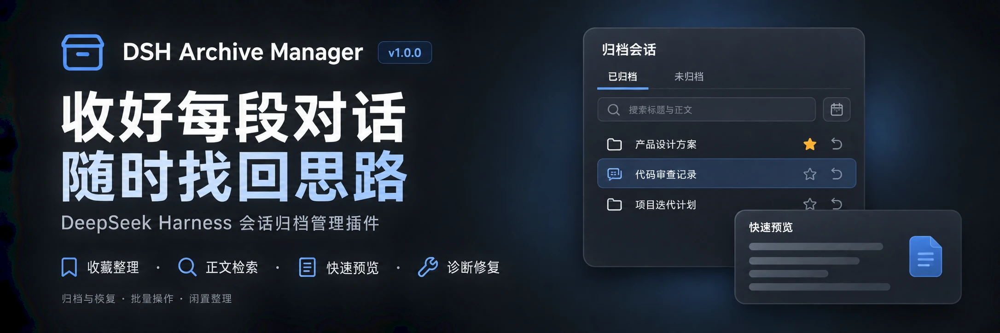

<p align="center">
  
</p>

<div align="center">

# DSH Archive Manager

  **在 DeepSeek Harness 中安全管理已归档会话**

  [简体中文](README.zh-CN.md) · [English](README.en.md) · [日本語](README.ja.md) · [Español](README.es.md) · [Français](README.fr.md) · [Deutsch](README.de.md) · [Русский](README.ru.md) · [Português](README.pt.md)

  [更新日志](CHANGELOG.zh-CN.md) · [Apache-2.0](LICENSE)

  [](LICENSE)
  [](https://www.npmjs.com/package/@michengai/dsh-archive-manager)
  [](https://www.npmjs.com/package/@michengai/dsh-archive-manager)
  [](https://github.com/MichengAI/dsh-archive-manager)
  [](#安装)
</div>

> DSH Archive Manager 是社区维护的 DeepSeek Harness（DSH）插件，并非 DeepSeek AI 官方产品。

本文描述 **1.3.2**。已发布变更见[更新日志](CHANGELOG.zh-CN.md)。

## 功能概览

把暂时不用的会话收起来，需要时再找回，让日常任务列表更清爽。

- **双入口与宽屏视图**：可在「设置 → 归档会话」管理，也可开启左侧主导航栏图标，在主工作区展开居中大面板。
- **归档与恢复**：支持单条会话归档、整工作区一键归档、跨项目批量归档，以及单条或批量恢复并直接打开。
- **全文检索与快速预览**：统一支持标题与历史消息正文搜索，支持按项目、收藏与日期范围组合筛选并切换排序；无需恢复即可快速预览上下文（支持 Markdown 排版与原文高亮切换）。
- **收藏与闲置会话整理**：支持星标收藏与「只看收藏」筛选；可按闲置天数预览并批量归档不活跃会话，自动保护运行中、等待交互与已收藏的会话，并支持撤回本次批量归档。
- **侧栏快捷菜单与跨工作区移动**：直接在侧栏工作区或会话行右键唤起操作菜单，支持收藏、归档、将普通会话移动到其他工作区，以及复制或打开工作区目录。
- **孤儿子代理清理与永久删除**：自动检测母会话已删除的残留子代理并一键清理；支持二次确认后永久删除不再需要的会话与日志。
- **多语言与反向代理适配**：完整支持 DeepSeek Harness 官方 8 门内置语言，跟随系统浅色/深色主题，并支持带路径前缀的反向代理部署。

## 界面预览

### 1. 归档管理面板

在「设置 → 归档会话 → 已归档」检索、筛选、收藏、快速预览、恢复或清理会话：


切换到「未归档」，按闲置天数预览整理建议，或按项目批量归档：


### 2. 主工作区大面板（侧边栏直达）

开启侧边栏入口后，点击左侧主导航即可在主工作区展开完整大面板：


### 3. 侧边栏右键与跨工作区移动菜单

在侧边栏工作区行或会话行右键，即可唤起快捷操作菜单与跨工作区移动子菜单：

| 工作区快捷菜单（复制/打开目录） | 会话跨工作区移动 |
| :---: | :---: |
|  |  |

## 安装

需要已安装并能正常运行 DeepSeek Harness。以下命令使用 `web` profile，请按实际环境替换。

- **宿主支持范围**：DeepSeek Harness `0.2.x` 全系列（`>=0.2.0-rc.1 <0.3.0-0`），已验证覆盖 `0.2.0-rc.1`～`0.2.2-rc.2` 全部 RC 版本（同一 RC 线中间的 alpha 不在支持范围内）。
- `0.2.0-rc.1` 之前的早期宿主不再支持，`0.3.0` 破坏性更新将由版本门自动拦截；仍在使用 `0.1.x` 的用户请安装插件 `1.0.20`。
- **反向代理部署**：支持部署在带路径前缀的反向代理后（如 `/app/dsh/`）。

### 让 Agent 帮你安装（推荐）

把这段话发给能够操作本机终端的 Agent：

```text
请把 @michengai/dsh-archive-manager 最新版安装到我的 DSH web profile，使用官方 npm 源，安装后确认生效并告诉我如何重新加载。
```

### 手动安装与更新

```powershell
[Console]::OutputEncoding = [System.Text.Encoding]::UTF8
$OutputEncoding = [System.Text.Encoding]::UTF8

dsh plugin --profile web add @michengai/dsh-archive-manager@latest --registry=https://registry.npmjs.org/
```

安装后重启 DSH Web，并硬刷新浏览器（`Ctrl+Shift+R`），打开「设置 → 归档会话」即可使用。更新时重新执行安装命令即可。

## 插件配置

打开 **主界面侧边栏「插件」→ 点击 `Archive Manager` 详情页**，可调整以下选项：

- **入口展示位置 (`entryLocation`)**
  - **两边显示 (`both`)**：在左侧主导航栏和「设置 → 归档会话」同时显示入口。
  - **仅侧边栏 (`sidebar`)**：仅在左侧主导航栏显示图标，隐藏设置页入口。
  - **仅设置 (`settings`)**（默认）：仅在「设置 → 归档会话」中显示。
- **侧栏收藏星标 (`sidebarFavoriteStar`)**
  - **全部显示 (`all`)**（默认）：在侧栏会话行悬停或已收藏时显示星标。
  - **仅已收藏 (`favorites`)**：仅在已收藏的会话行常驻显示星标，未收藏会话悬停时不显示。
  - **完全隐藏 (`none`)**：隐藏侧栏会话行上的星标，仍可通过右键菜单收藏并配合「只看收藏」筛选。

## 使用指南

| 操作 | 说明 |
| --- | --- |
| **归档会话** | 在侧栏会话菜单选择「归档会话」，或在「未归档」页勾选后批量归档 |
| **归档工作区 / 项目** | 在侧栏工作区菜单选择「归档工作区」，或在「未归档」页点击分组右侧「…」归档整组（不受搜索筛选影响） |
| **搜索与筛选** | 搜索框默认同时检索标题与消息正文，可组合「只看收藏」、排序方式、项目与日期范围筛选（日期选择器支持键盘方向键与预设） |
| **快速预览** | 点击搜索命中片段或「更多 → 快速预览」，无需恢复即可查看上下文与关键词高亮 |
| **查看或恢复对话** | 点击会话标题可在归档状态下查看并继续对话；点击恢复图标或「更多 → 恢复打开」可将对话移回工作区 |
| **收藏会话** | 点击会话行右侧星标或使用侧栏右键菜单收藏，再通过视图菜单「只看收藏」筛选 |
| **整理闲置会话** | 在「未归档」页设定闲置天数（1～36500）并预览候选，确认后批量归档；关闭或刷新页面前可点击「撤回本次归档」 |
| **跨工作区移动** | 在侧栏会话右键菜单选择「移动到工作区」，将普通会话迁移到其他已登记工作区 |
| **清理孤儿子代理** | 若检测到母会话已删除的无主子代理，整理区域会显示空间占用并支持一键清理 |
| **重建缺失列表缓存** | 若检测到部分会话缺少官方列表缓存，整理区域会按需显示「重建列表缓存」卡片，点击即可只读日志修复标题等列表信息 |
| **永久删除** | 勾选会话后点击「删除」（或使用侧栏右键菜单），二次确认后彻底清除日志与缓存 |
| **复制会话 ID** | 在「更多」菜单选择「复制会话 ID」 |

### 注意事项

- **收藏与闲置保护**：收藏状态保存在宿主数据中，归档或恢复不会丢失。闲置整理会自动排除已收藏、当前打开、正在运行及等待交互的会话；已收藏会话仍可手动归档。没有定时后台自动归档。
- **搜索范围**：正文搜索包含用户与助手消息文本，不包含工具输出、附件、推理或系统消息。插件不建立持久化全文索引，会话较多时建议先按项目、日期或收藏缩小范围。
- **批量操作与撤回**：批量归档、恢复或删除如遇单项失败会跳过继续并支持只重试失败项；「撤回本次归档」仅在当前管理页面未关闭或刷新前有效；永久删除无法撤回。

## 常见问题

### 安装后找不到入口？

先重启 DSH Web 并硬刷新浏览器（`Ctrl+Shift+R`），确认安装到了当前使用的 profile。若仍未显示，可执行以下命令检查配置中是否包含 `ui-workspace-archive-manager`，且未在 profile 的 `cordis.patch.yml` 中禁用官方 `workspace`、`session-projection-cache` 或 `ui-workspace`：

```powershell
[Console]::OutputEncoding = [System.Text.Encoding]::UTF8
$OutputEncoding = [System.Text.Encoding]::UTF8

dsh --profile web --dump-config
```

### 归档和永久删除有什么区别？

归档只是把会话收起来，随时可以恢复。**永久删除无法撤销**，会彻底清除该会话的日志、缓存与附件（不会删除你的项目工作目录），删除前需要再次确认。

### 可以和 Codex UI 或其他归档插件一起使用吗？

可以。插件与 [Codex UI](https://github.com/MichengAI/dsh-codex-ui) 完全兼容；若同时安装了其他归档插件，各自在设置中独立显示入口，互不影响。

遇到其他问题，请提交 [Issue](https://github.com/MichengAI/dsh-archive-manager/issues)，附上 DSH 与插件版本、复现步骤和错误信息。

## 从源码安装

<details>
<summary>开发或测试未发布改动时展开</summary>

```powershell
[Console]::OutputEncoding = [System.Text.Encoding]::UTF8
$OutputEncoding = [System.Text.Encoding]::UTF8

git clone https://github.com/MichengAI/dsh-archive-manager.git
Set-Location .\dsh-archive-manager
pnpm install --frozen-lockfile
pnpm build
dsh plugin --profile web add .
```

完成后重启 DSH Web 并硬刷新浏览器。修改 [src](src) 源码后，提交前请先运行 `pnpm build`（常用校验：`pnpm typecheck`、`pnpm test`、`pnpm verify`）。

</details>

## DSH 产品生态

想使用桌面工作台，可下载 [DSH Codex Desktop](https://github.com/MichengAI/dsh-codex-desktop/releases)；已有 [DeepSeek Harness](https://github.com/deepseek-ai/deepseek-harness) 环境，可按各项目 README 按需安装。以下列出 11 个自研插件；桌面端实际随附范围以对应版本的发行说明和内置清单为准。

| 插件 | 你可以用它做什么 |
| --- | --- |
| [Codex UI](https://github.com/MichengAI/dsh-codex-ui) | 整理项目与会话、搜索任务、跳转对话轮次 |
| [Agency Agents](https://github.com/MichengAI/dsh-agency-agents) | 按任务选择并召唤专业角色 |
| [Skills Manager](https://github.com/MichengAI/dsh-skills-manager) | 统一查找、启停、创建和导入本机技能 |
| [Archive Manager](https://github.com/MichengAI/dsh-archive-manager) | 搜索、恢复或清理已归档会话 |
| [IM Connect](https://github.com/MichengAI/dsh-im-connect) | 从消息平台下任务、收回复 |
| [Automation](https://github.com/MichengAI/dsh-automation) | 按计划执行任务，查看每次运行的结果 |
| [BTW](https://github.com/MichengAI/dsh-btw) | 在当前上下文中临时旁问，不打断主任务 |
| [Simplify](https://github.com/MichengAI/dsh-simplify) | 用 `/simplify` 整理 Git 改动范围内的代码 |
| [PUA](https://github.com/MichengAI/dsh-pua) | 引导 Agent 在失败时换方法、查原因，并在完成前验证结果 |
| [Code Review](https://github.com/MichengAI/dsh-code-review) | 用 `/review` 发起独立 Agent 代码审查，在当前会话接收报告 |
| [Codex Pet](https://github.com/MichengAI/dsh-codex-pet) | 通过桌面宠物查看会话提醒、处理工具审批和问题回答 |


## 许可证

本项目采用 [Apache License 2.0](LICENSE)。
