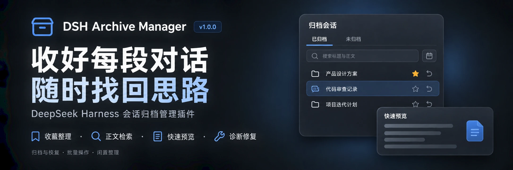

<p align="center">
  
</p>

<div align="center">

# DSH Archive Manager

  **在 DeepSeek Harness 中安全管理已归档会话**

  [English](README.md) · [Русский](README.ru.md) · [更新日志](CHANGELOG.zh-CN.md) · [Apache-2.0](LICENSE)

  [](LICENSE)
  [](https://www.npmjs.com/package/@michengai/dsh-archive-manager)
  [](https://www.npmjs.com/package/@michengai/dsh-archive-manager)
  [](https://github.com/MichengAI/dsh-archive-manager)
  [](#前置条件)
</div>

> DSH Archive Manager 是社区维护的 DeepSeek Harness（DSH）插件，并非 DeepSeek AI 官方产品。

本文描述 **1.1.10**。已发布变更见[更新日志](CHANGELOG.zh-CN.md)。

## 功能概览

把暂时不用的会话收起来，需要时再找回，让日常任务列表更清爽。

- **多视图与侧栏直达**：支持开启主侧边栏直接导航入口，在主工作区以 **960px 居中版心** 展开「已归档」与「未归档」完整大面板，告别狭窄弹窗。
- **全生命周期管理**：支持单条会话归档、全工作区一键归档、跨项目批量归档、单条/批量恢复并打开会话。
- **纯净自适应单行工具栏**：采用宿主原生 `Input` 原语，内置官方放大镜图标与绿色呼吸聚焦边框，自适应弹性撑满；控件按「输入框、查询条件、所有项目、时间选择」极简单行排列，锁死盒模型杜绝溢出重叠。
- **全文联合检索与 Codex 复合菜单**：默认自动联合搜索标题与正文历史（用户与助手消息）；将会话筛选（全部/只看收藏）与排序收归为 Codex 风格两段式复合菜单，完全采用宿主原生对勾原语。
- **轻量单字段日期胶囊与日历浮层**：彻底告别原生日期选择器的暗黑模式反白与失焦缺陷（#74），单行展示时间范围；浮层支持快捷预设、中英俄三语原生排版，以及完备的 WAI-ARIA 键盘无障碍漫游（上下左右键、Home/End、PageUp/Down 及月末夹紧）与高亮区间实时拉伸预览。
- **智能闲置会话整理**：自定义闲置天数，自动分析并排除正在运行、等待交互及已收藏的关键会话，支持预览候选后确认归档，并提供误操作撤回机制。
- **原生侧边栏菜单注入**：在原生侧栏工作区 `...` 菜单中安全注入「归档会话」项，弹出锚定工作区行的毛玻璃二次确认框，严格遵循「所见即所归」原则。
- **永久彻底清理**：确认后永久删除不再需要的会话，彻底清除物理日志、索引与缓存，支持错误项独立重试。
- **异常会话诊断与修复**：对损坏的 Zstandard 压缩帧日志与历史特定来源异常会话提供原地诊断和安全修复。
- **可控在线更新与反向代理适配**：提供独立在线更新开关与企业级宿主配置硬锁定；原生适配反代子路径前缀部署。

## 异常会话诊断与修复

归档页自动汇总读取异常，展开「诊断与修复」可查看原因和处理建议。点击「诊断会话」，符合规则时再点击「确认修复」。当前支持旧自动化来源，以及早期的参考文档提示和工作约定来源，保留原日志与正文。修复要求会话已归档且未在任何 DSH 进程中打开；文件缺失、权限问题与未知损坏只给出处理建议，不删除或截断日志。

## 检索与预览

- 已归档与未归档统一支持标题／正文搜索、日期、项目、收藏及创建时间排序；两边均可通过星标收藏和取消收藏。未归档的正文命中点击打开完整会话。

- 快速预览默认以 Markdown 排版展示，支持表格、引用与代码块，区分用户和助手；可切换为原文与关键词高亮。

- 搜索框默认直接联合搜索当前页签会话中的标题与正文历史（包含用户和助手文本），无需手动切换范围。
- 搜索框右侧「日期」可选择或清除更新时间范围；项目、收藏和更新时间范围可组合使用；结束日期包含本地当天。已归档和未归档页均支持正文搜索与这些筛选条件。
- 正文命中显示片段和关键词高亮；已归档页点击片段或「更多 → 快速预览」查看上下文，不恢复会话；未归档页点击片段打开完整会话。没有关键词时预览最近八条消息，有关键词时定位首个命中附近。
- 检索逐批读取，每批最多 20 条会话，批内逐条读取；关键词最多 200 字符。预览每条最多 2000 个 UTF-16 码元，截断保留完整 Unicode 字符，较长内容请打开完整会话。
- 搜索与预览不包含工具输出、附件、推理、系统或插件注入消息；读取失败会显示详情并支持重试。检索的是持久化原始文本，不等同于模型当前上下文。
- 未建立持久化全文索引，大量或超长会话可能需要较久，建议先缩小项目、日期或收藏范围；尚无可承诺的会话数量上限或响应时延；更改条件会停止后续批次，正在读取的单批仍会完成，但旧结果不会覆盖新筛选。
## 轮次与定位

- 已归档和未归档列表均在时间旁显示轮次。每条用户提交消息算一轮，包括图片消息；助手回复、工具调用和插件注入不计入。
- 排序菜单新增「轮次最多／轮次最少」，轮次相同按更新时间及标题排序。读取失败显示「轮次未知」，放在已知轮次之后，并提供失败明细和重试。
- 每行「更多」菜单提供「复制会话 ID／复制会话路径」。官方 JSONL 存储复制会话目录，其他后端复制宿主提供且存在的文件路径；路径缺失会提示，不猜测路径。
- 详情每批读取最多 20 条，不激活或恢复会话。统计来自原始日志；分支中继承的用户消息也计入。较多长日志可能需要等待，未建立持久化轮次索引。
- 剪贴板需要 HTTPS 或本机地址及浏览器权限；复制失败会明确提示，不显示成功。

## 界面预览

在「设置 → 归档会话 → 已归档」检索、收藏、预览、恢复和清理：


切换到「未归档」，使用相同筛选条件整理会话，预览闲置归档或按项目批量归档：


*截图展示核心功能面板，包含已归档会话检索筛选与未归档闲置整理。采用无损 WebP 格式。*

## 安装

需要已安装并能正常运行 DeepSeek Harness。以下命令使用 `web` profile，请按实际环境替换。

插件安装支持 npm registry、本地构建的 `.tgz` 包和 GitHub。GitHub 与 npm 都包含可直接运行的 `lib`。改动源码后，提交前请先运行构建。

### 让 Agent 帮你安装

把这段话发给能够操作本机终端的 Agent：

```text
请把 @michengai/dsh-archive-manager 最新版安装到我的 DSH web profile，使用官方 npm 源，安装后确认生效并告诉我如何重新加载。
```

### 手动安装

```powershell
[Console]::OutputEncoding = [System.Text.Encoding]::UTF8
$OutputEncoding = [System.Text.Encoding]::UTF8
dsh plugin --profile web add @michengai/dsh-archive-manager@latest --registry=https://registry.npmjs.org/
```

安装后重启 DSH Web，并刷新页面（或按 `Ctrl+Shift+R` 硬刷新浏览器），打开「设置 → 归档会话」即可使用。更新时可点击「检查更新」，或重新执行安装命令。

- `1.1.10` 已验证兼容 DeepSeek Harness `0.2.0-rc.1`、`0.2.0-rc.2`、`0.2.1-rc.1`、`0.2.1-rc.2`、`0.2.1-rc.3`。
- 不再支持 `0.2.0` 之前的宿主。仍在使用 `0.1.x` 的，请安装插件 `1.0.20`，不要装 `@latest`。
- **反向代理部署**：支持将 DSH 部署在带路径前缀的反向代理后面（如 `/app/dsh/`），插件 API 与更新检查端点统一自动按页面基址（`document.baseURI`）相对解析，避免丢失代理路径前缀导致 404。

## 插件配置与可选开关

插件遵循 DSH 官方扩展配置规范，配置项位于：
> **主界面侧边栏「插件」→ 点击 `Archive Manager` 详情页**（对应宿主 `plugins.bundle.config` 槽位）。

此处提供两个原生扁平行开关：

### 1. 侧边栏入口 (`sidebarEntry`)
- **默认状态**：关闭（`false`）
- **功能说明**：在宿主左侧主导航栏的「插件」下方增加常驻的 **「归档」** 图标入口。
- **生效效果**：
  - 开启后，在侧边栏点击即可直达归档中心，并在主工作区以 **960px 居中版心**（对齐官方插件管理与市场规范）展开完整大面板，彻底告别在设置弹窗狭窄视口内滚动的局限；
  - 关闭后安全注销侧栏槽位（若当前正停留在归档大面板，会自动安全切回默认视图，防止悬空和白屏）；
  - 无论是否开启侧栏入口，DSH 原有的「设置 → 归档会话」入口始终保留，两处界面数据与操作 100% 实时同步。

### 2. 在线更新 (`onlineUpdate` / `updater`)
- **默认状态**：开启（`true`）
- **功能说明**：控制是否允许在线检查并安装归档管理器的新版本。
- **生效效果**：
  - **界面联动**：关闭开关后，归档管理面板标题旁的「检查更新」按钮与版本提示徽标将即时隐藏，无需刷新页面；开启后自动恢复展示；
  - **接口安全拦截**：关闭后，服务端的更新路由对任何版本检查和安装请求均返回 `HTTP 403` 禁用状态，彻底杜绝在插件内安装未审核版本；
  - **宿主/平台级锁定**：面向精选插件索引（如 VibeDev）或企业安全合规环境，支持直接在 Cordis 配置文件（bundle patch）中声明，无需进入界面手动配置：
    ```yaml
    updater: false # 或 onlineUpdate: false
    ```
    配置生效后，更新器在启动时即被完全禁用，更新入口隐藏，详情页在线更新开关置灰。宿主锁定优先于本地配置中的用户选择，界面不能解除锁定；宿主移除锁定后，重新按已保存的用户选择生效。

## 使用指南

| 核心操作 | 操作方式 |
| --- | --- |
| **归档一条会话** | 打开侧栏会话菜单，选择「归档会话」 |
| **归档整个工作区** | 打开工作区菜单，选择归档该工作区的会话（弹出就地确认卡片） |
| **检索与筛选** | 打开「设置 → 归档会话」或点击侧边栏「归档」，搜索框自动联合检索标题与正文；使用 Codex 风格视图菜单切换「全部会话 / 只看收藏」与排序；按「所有项目」下拉过滤特定项目；使用单字段日期胶囊选择时间范围 |
| **自研日历与键盘漫游** | 点击日期胶囊展开轻量日历浮层，提供全部时间与常用预设；支持完整键盘无障碍漫游（上下左右键移动、Home/End 周首周末跳转、PageUp/Down 跨月切换、Enter/Space 选定），并提供区间高亮实时拉伸预览 |
| **快速预览** | 点击命中片段或「更多 → 快速预览」，无需恢复即可查看上下文与原文高亮 |
| **调整排序** | 统一在视图菜单中按更新时间、创建时间、标题、轮次最多／最少排序 |
| **恢复会话** | 点击会话右侧恢复图标；「更多」菜单可「恢复打开」直接进入原会话继续对话 |
| **项目整体归档** | 在「未归档」页点击分组右侧“…”菜单，确认归档该组全部聊天（不受搜索影响） |
| **收藏会话** | 点击行右侧星标，使用视图菜单「只看收藏」快速过滤重要会话 |
| **整理闲置会话** | 在未归档页设置闲置天数，自动排除运行中、等待交互与收藏的会话，预览并确认归档 |
| **撤回归档** | 批量归档后可在关闭页面前点击「撤回本次归档」，安全恢复误归档会话 |
| **永久彻底删除** | 勾选单条或多条会话后点击「删除」，二次确认后彻底清除日志与缓存，支持错误项重试 |
| **处理损坏日志** | 展开「诊断与修复」，针对单帧 Zstandard 压缩损坏或特定历史异常会话执行原地诊断修复 |
| **定位会话文件** | 在更多菜单选择「复制会话 ID」或「复制会话路径」 |

页面默认打开「已归档」，右侧「未归档」用于批量归档。切换 TAB 会清空选择；切换搜索或项目筛选会保留已选会话。批量操作前留意隐藏的已选数量，或先清空选择。

### 收藏与闲置整理

会话使用紧凑分组列表，点击项目标题可以折叠；右侧提供星标和恢复／归档图标，已归档会话的「更多」菜单提供恢复打开和删除。折叠只影响展示，「全选当前筛选结果」仍包含折叠组内符合筛选的会话。

- 在已归档或未归档会话行右侧点击星标，通过收藏下拉菜单中的「只看收藏」找回重要会话。收藏保存在宿主数据中，归档、恢复或更换浏览器不会清除；其他页面修改的收藏可在重新打开管理页后读取。
- 在「未归档」设置 1～36500 的整数闲置天数，结合当前项目、搜索、日期和收藏筛选，点击「预览闲置归档」。确认清单允许逐条取消，默认排除收藏、当前打开、正在执行（含子代理）以及等待交互的会话；缺少有效最后活动时间的会话不参与。
- 归档前再次检查收藏和活动状态。批量归档、恢复、删除显示进度与成功、跳过、失败数量；某一条失败后继续处理后续，只重试失败项。删除重试仍需确认。
- 「撤回本次归档」只恢复最近一批实际归档成功的会话，包括该批重试成功的部分。仅在本次打开管理页期间有效，关闭页面或刷新会清除记录；不会撤回原有归档，也不能恢复永久删除的会话。
- 收藏会话仍可手动归档；收藏保护只针对闲置整理。没有定时自动归档，不会在后台自行整理。

「全选当前筛选结果」只选择符合当前条件的会话。项目菜单的整体操作仍作用于该项目全部会话，不受搜索筛选影响。未归档页排除子代理和空白占位会话。

设置页与侧栏的批量归档、批量恢复均串行调用官方单条接口 `ctx.workspaces.archiveSession` 和 `ctx.workspaces.unarchiveSession`。

### 查看并继续归档对话

原生会话导航自 `0.1.40` 起提供，1.0.0 的操作入口如下：

- **点击会话标题**：打开 DSH 原生会话页，查看消息、附件和工具详情；可直接继续聊天，保持归档状态。
- **更多菜单 → 恢复打开**：取消归档后进入原会话，继续工作。

## 检索接口兼容约定（集成开发者）

正式入口为 `workspaceRegistry.searchSessionContent({ sessionIds, query })`，支持已归档与未归档会话。输入为 1～20 个会话 ID 和 1～200 字符非空关键词，ID 去重后处理。成功返回 `{ items: [{ sessionId, seq, snippet }], failures: [{ sessionId, message }] }`；单条读取失败进入 `failures`，参数不合法则拒绝整个调用。

`searchArchivedContent` 是旧客户端兼容入口，仅接受归档范围，保持原有语义。两者通过宿主 Typert 的既有连接与权限边界调用，无新增 HTTP 端点或鉴权配置。当前受支持版本范围内保留旧描述符，不在补丁版本移除；只有未来明确收窄兼容范围、完成客户端迁移并发布弃用说明后才删除。新客户端优先使用正式入口，旧入口仅用于旧版本回退；不应向两个入口重复发送同一检索。

## 更新

在归档管理页标题处点击「检查更新」。支持自动更新的 DSH CLI 或 Desktop 环境可直接更新；其他环境会提供适用于当前 profile 的手动命令。也可重新执行上面的安装命令。

## 常见问题

### 安装后找不到入口？

先重启 DSH Web 并硬刷新浏览器，确认安装到了当前使用的 profile。仍未显示时，执行：

```powershell
[Console]::OutputEncoding = [System.Text.Encoding]::UTF8
$OutputEncoding = [System.Text.Encoding]::UTF8

dsh --profile web --dump-config
```

配置中应包含 `ui-workspace-archive-manager`，且不应再禁用官方 `workspace` 或 `session-projection-cache`。若还留着 `archive-manager-host` 的禁用覆盖，可以删掉。当前 DSH 宿主已无官方 `ui-settings-unarchive-sessions` 入口，本插件不再对其 disable（否则 dump-config 会告警条目不存在）。若 profile 的 `cordis.patch.yml` 仍禁用 `workspace`、`session-projection-cache` 或 `ui-workspace`，请移除这些覆盖，再重启。

### 从旧版升级后，停用时标题还会丢吗？

修复版不再接管官方投影缓存表。启用时会核验历史插件缓存对应的会话身份，并将可接受的记录交接给官方缓存；旧缓存文件保留，不会自动删除。**之前已停用旧版的用户，需要至少启用一次修复版完成交接**，不能只在禁用状态下替换安装包。

交接失败可在后续启用时重试。官方后端不接受的 key（例如含冒号的会话 ID）不会强行迁入，仍保留在旧插件域；这些会话恢复宿主原生缓存行为，不代表其聊天日志被删除。完整边界见[更新日志](CHANGELOG.zh-CN.md)。

### 归档和删除有什么区别？

归档只是收起会话，可以恢复。**永久删除无法撤销**，并可能一并清理该会话的附件；不会删除你的项目工作目录。删除前会要求确认。

### 可以和 Codex UI 一起使用吗？

可以。保留 [Codex UI](https://github.com/MichengAI/dsh-codex-ui) 的侧栏样式和交互，归档管理仍在「设置 → 归档会话」中。

遇到其他问题，请提交 [Issue](https://github.com/MichengAI/dsh-archive-manager/issues)，附上 DSH 与插件版本、复现步骤和错误信息。

## 从源码安装

<details>
<summary>开发或测试未发布改动时展开</summary>

在你选择的源码目录中执行以下命令。未推送的本地改动需使用已有工作副本。

```powershell
[Console]::OutputEncoding = [System.Text.Encoding]::UTF8
$OutputEncoding = [System.Text.Encoding]::UTF8

git clone https://github.com/MichengAI/dsh-archive-manager.git
Set-Location .\dsh-archive-manager
pnpm install --frozen-lockfile
pnpm build
dsh plugin --profile web add .
```

完成后重启 DSH Web 并硬刷新浏览器。业务源码统一在 [src](src) 中使用 TypeScript 严格模式；共享协议在 `contracts.ts`，宿主版本适配在 `host-compat.ts`、`client-compat.ts`，客户端组件与状态类型在 `client-types.ts`。GitHub 与 npm 都包含可直接运行的 `lib`。改了源码后，提交前运行 `pnpm build`，否则源码安装仍是旧的运行文件。`pnpm typecheck` 检查业务源码和类型负例，`pnpm test` 先检查类型、构建再执行回归，`pnpm verify` 还执行兼容矩阵和打包检查。测试与构建脚本继续使用 `.mjs`；对外发布仍为 JavaScript，不要求宿主加载 TypeScript。

</details>

## DSH 产品生态

想使用桌面工作台，可下载 [DSH Codex Desktop](https://github.com/MichengAI/dsh-codex-desktop/releases)；已有 [DeepSeek Harness](https://github.com/deepseek-ai/deepseek-harness) 环境，可按各项目 README 按需安装。以下列出 11 个自研插件；桌面端实际随附范围以对应版本的发行说明和内置清单为准。

| 插件 | 你可以用它做什么 |
| --- | --- |
| [Codex UI](https://github.com/MichengAI/dsh-codex-ui) | 整理项目与会话、搜索任务、跳转对话轮次 |
| [Agency Agents](https://github.com/MichengAI/dsh-agency-agents) | 按任务选择并召唤专业角色 |
| [Skills Manager](https://github.com/MichengAI/dsh-skills-manager) | 统一查找、启停、创建和导入本机技能 |
| [Archive Manager](https://github.com/MichengAI/dsh-archive-manager) | 搜索、恢复或清理已归档会话 |
| [IM Connect](https://github.com/MichengAI/dsh-im-connect) | 从消息平台下任务、收回复 |
| [Automation](https://github.com/MichengAI/dsh-automation) | 按计划执行任务，查看每次运行的结果 |
| [BTW](https://github.com/MichengAI/dsh-btw) | 在当前上下文中临时旁问，不打断主任务 |
| [Simplify](https://github.com/MichengAI/dsh-simplify) | 用 `/simplify` 整理 Git 改动范围内的代码 |
| [PUA](https://github.com/MichengAI/dsh-pua) | 引导 Agent 在失败时换方法、查原因，并在完成前验证结果 |
| [Code Review](https://github.com/MichengAI/dsh-code-review) | 用 `/review` 发起独立 Agent 代码审查，在当前会话接收报告 |
| [Codex Pet](https://github.com/MichengAI/dsh-codex-pet) | 通过桌面宠物查看会话提醒、处理工具审批和问题回答 |


## 许可证

本项目采用 [Apache License 2.0](LICENSE)。
